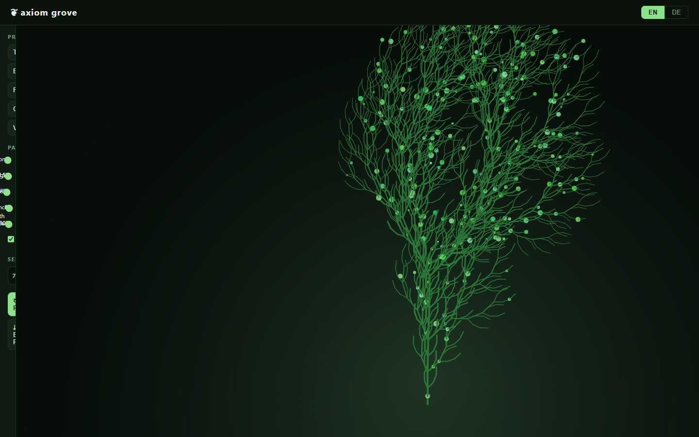
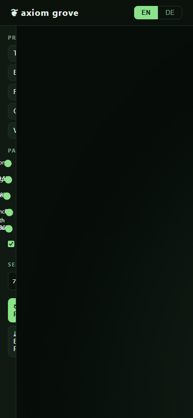

# Axiom Grove — Generative L-System Botanicals

Grow procedural plants and trees with Lindenmayer systems. Tune rules, angles and randomness, then export your botanical artwork as a high-resolution PNG.

<div align="center">


**[Live Demo](https://ruslanfridenli.github.io/axiom-grove/)** · **[Deutsch ↓](#-deutsch)**

</div>

---

## Screenshots






## Features

- Classic and custom L-system rule sets
- Angle, iteration, randomness and branch-width controls
- Seeded randomness — every garden is reproducible
- Organic color palettes and gradient stems
- Export artwork as PNG at up to 4K
- English/German interface

## Local development

```bash
git clone https://github.com/ruslanfridenli/axiom-grove.git
cd axiom-grove
# open index.html in a browser, or serve statically:
npx serve .
```

No build step, no dependencies — pure static site.

---

## 🇩🇪 Deutsch

### Axiom Grove — Generative L-System-Botanicals

Züchte prozedurale Pflanzen und Bäume mit Lindenmayer-Systemen. Regeln, Winkel und Zufall justieren und die botanische Kunst als hochauflösendes PNG exportieren.

### Funktionen

- Klassische und eigene L-System-Regelwerke
- Regler für Winkel, Iterationen, Zufall und Strichstärke
- Gesperrter Zufall — jeder Garten ist reproduzierbar
- Organische Farbpaletten und Verlaufsstämme
- Export als PNG bis 4K-Auflösung
- Englische/deutsche Oberfläche

### Lokale Entwicklung

```bash
git clone https://github.com/ruslanfridenli/axiom-grove.git
cd axiom-grove
npx serve .
```

Reine statische Seite — kein Build-Schritt, keine Abhängigkeiten.

---

## ☕ Support / Unterstützen

Wenn dir diese Website beim Lernen hilft, würde mir eine Spende sehr viel bedeuten und dabei helfen, sie weiterzuentwickeln. Alternativ kannst du das Projekt mit einem Stern im github repo unterstützen. Vielen Dank!

- Solana: `zQpgZ6nGigww7vYpz3Qqxb1BT44kqS567vFaLTeHagS`
- Ethereum: `0x9c4fE1B2e9a1A9c22312c8296BB088Ca0e8F1B4e`
- Bitcoin: `bc1p2jltk9ya9kyzv35d8kxn7mmg9jqkx66cqtgzqwe75zlr4v9jk4hsv468q7`

---

Made with care. Feedback welcome via issues.
